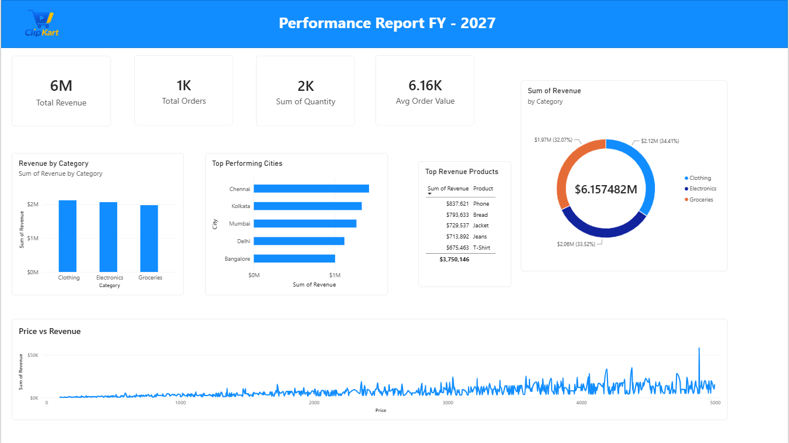

# ClipKart Sales Performance Dashboard --- Power BI

An interactive sales performance dashboard built in **Microsoft Power
BI** for ClipKart. The report summarizes revenue, orders, quantity sold,
average order value, category performance, product revenue, and
city-level performance in one view.

## Dashboard Preview



> The dashboard screenshot above shows the report layout and the
> displayed figures from the current report.

## Project Objectives

-   Present core sales KPIs in a clear, at-a-glance layout.
-   Compare revenue across product categories.
-   Identify products contributing the most revenue.
-   Compare revenue performance across cities.
-   Explore the relationship between product price and revenue.
-   Practice data preparation, data modeling, visualization, and report
    formatting in Power BI.

## Tools & Technologies

-   **Microsoft Power BI Desktop** --- report development and
    visualization
-   **Power Query Editor** --- data preparation and transformation
-   **DAX** --- measures and calculations, where used in the report
-   **Power BI Template (`.pbit`)** --- reusable report template

## Dashboard Highlights

### Key Performance Indicators

The report includes four KPI cards:

  KPI                     Displayed value
  --------------------- -----------------
  Total Revenue                        6M
  Total Orders                         1K
  Total Quantity Sold                  2K
  Average Order Value               6.16K

*Values are shown as displayed in the dashboard and may be rounded by
the visual formatting.*

### Visualizations

-   **Revenue by Category** --- compares revenue for Clothing,
    Electronics, and Groceries.
-   **Top Performing Cities** --- compares revenue across Chennai,
    Kolkata, Mumbai, Delhi, and Bangalore.
-   **Top Revenue Products** --- displays high-revenue products,
    including Phone, Bread, Jacket, Jeans, and T-Shirt.
-   **Revenue Share by Category** --- a doughnut chart showing each
    category's share of total revenue.
-   **Price vs Revenue** --- a chart for exploring how revenue varies
    across price values.

## Observations from the Dashboard

-   Clothing represents approximately **34.41%** of category revenue in
    the displayed chart.
-   Electronics represents approximately **33.52%**.
-   Groceries represents approximately **32.07%**.
-   Chennai is shown as the highest-revenue city among the cities
    displayed.
-   Phone is the highest-revenue product among the products listed in
    the table.

These observations describe the visible report; they are not causal
conclusions or forecasts.

## Data Preparation

The project workflow includes preparing the sales data before analysis.
Depending on the source dataset and transformations used, this can
include:

-   Checking and assigning appropriate data types.
-   Reviewing missing values and data-quality issues.
-   Removing duplicate records where appropriate.
-   Recreating or validating the Revenue field using the relevant source
    columns.
-   Checking that fields used by the visuals are suitable for analysis.

## Open the Power BI Template

1.  Download or clone this repository.
2.  Open `ClipKart Performance Report FY 2027.pbit` in **Power BI
    Desktop**.
3.  If Power BI asks for data-source details or parameters, provide the
    required source information.
4.  Refresh the data if required.
5.  Review the report visuals and interact with any available filters or
    slicers.

> **Note:** A `.pbit` file is a Power BI template, not the same as a
> `.pbix` report file. Depending on how the template was created, the
> original dataset may need to be connected again when the template is
> opened. Do not commit confidential or personally identifiable data to
> a public repository.

## Repository Contents

``` 
├── ClipKart Performance Report FY 2027.pbit
├── README.md
└── assets/
    └── dashboard.png
    └── logo.png
    └── 1780981841717-clipkart_ecommerce_data.csv
```

Keep the screenshot at `assets/dashboard.png` so the preview
above renders correctly on GitHub. If you use a different filename or
folder, update the image path in this README.

## Skills Demonstrated

-   Power BI report design
-   Power Query data preparation
-   KPI presentation and business reporting
-   Category, product, and geographic sales analysis
-   Data visualization and dashboard formatting

## Future Improvements

-   Add date-based slicers and monthly/quarterly revenue trends if the
    dataset contains date fields.
-   Add drill-through pages for product and city details.
-   Include targets and year-over-year comparisons if suitable
    historical or target data is available.
-   Document the dataset's source, field definitions, and any DAX
    measures used.

------------------------------------------------------------------------

**Project:** ClipKart Sales Performance Dashboard\
**Reporting label shown in dashboard:** FY 2027
